# 🌿 GreenLeaf Nursery Catalog

A plant nursery catalog website with plant details, care tips and a watering reminder. Built for **ISE-2: DevOps and Kubernetes**.

**Student:** Shruti Sawant

**Repository:** https://github.com/Shrutiii27/plant-nursery-catalog

---

## 1. Introduction and Objective

GreenLeaf Nursery Catalog helps plant lovers browse plants, learn basic plant care, and plan when to water each plant.

**Objectives:**
- Build a working website using HTML, CSS and JavaScript
- Use Git and GitHub for version control with meaningful commits
- Integrate a DevOps tool (Docker and GitHub Actions) to build and test the website automatically

---

## 2. Technology Stack

| Area | Technology |
|---|---|
| Frontend | HTML5, CSS3, JavaScript |
| Version control | Git, GitHub |
| Containerization | Docker (Nginx) |
| CI/CD | GitHub Actions |
| Editor / Terminal | VS Code, Git Bash |

---

## 3. Project Structure

```
plant-nursery-catalog/
├── .github/workflows/ci.yml
├── css/style.css
├── js/script.js
├── assets/
├── screenshots/
├── index.html
├── Dockerfile
├── .dockerignore
└── README.md
```

---

## 4. How to Run the Website

**Option 1: Open directly**
```bash
git clone https://github.com/Shrutiii27/plant-nursery-catalog.git
cd plant-nursery-catalog
start index.html
```

**Option 2: Using Docker**
```bash
docker build -t plant-nursery-catalog .
docker run -p 8080:80 plant-nursery-catalog
```
Then open http://localhost:8080


---

## 5. Changes Made

I made **5 website changes**, each as a separate commit and pushed to GitHub.

| # | Change | Commit message |
|---|--------|----------------|
| 1 | Basic page with plant list | `Initial commit: add basic page structure with plant list` |
| 2 | Green theme and card styling | `style: add green theme and plant card styling` |
| 3 | Plant cards with type, description, price | `feat: add plant cards with type, description and price` |
| 4 | Plant care tips section | `feat: add plant care tips section` |
| 5 | Watering reminder (JavaScript) | `feat: add watering reminder with JavaScript` |

### Change 1: Basic page structure

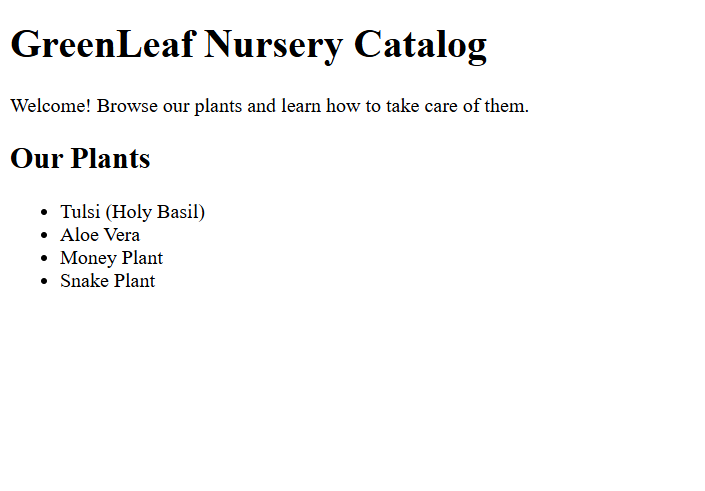

*Figure 1: First version with a plain plant list*

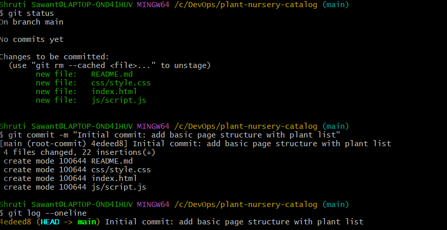

*Figure 2: Git log showing the first commit*

### Change 2: Green theme and styling

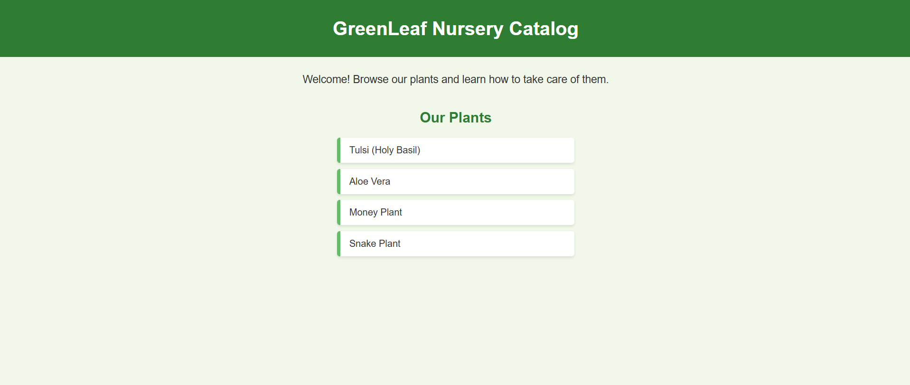

*Figure 3: Website after adding the green theme (CSS)*

### Change 3: Plant cards

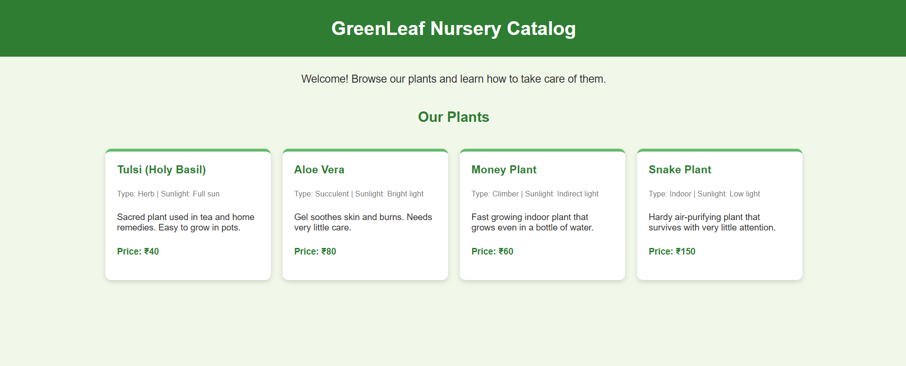

*Figure 4: Plant cards with type, description and price*

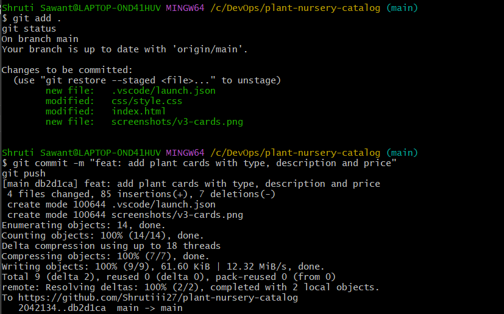

*Figure 5: Committing and pushing the plant cards change*

### Change 4: Care tips section

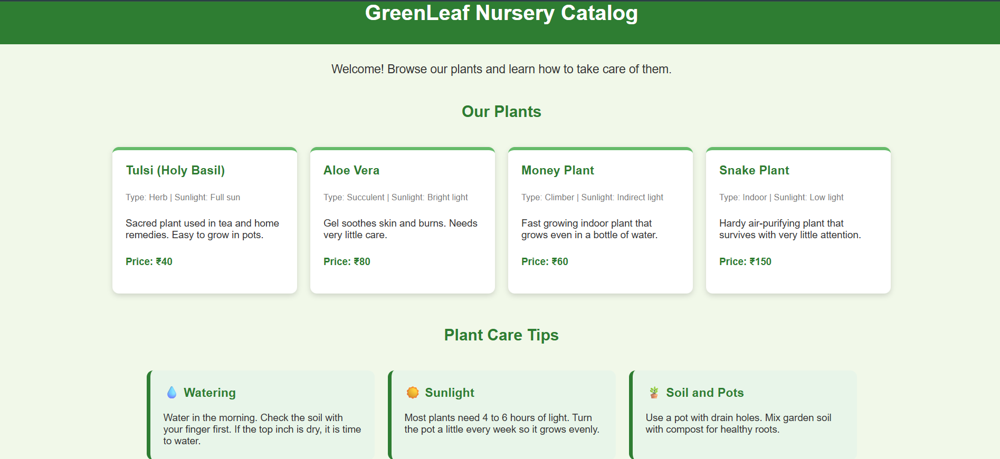

*Figure 6: Plant Care Tips section*

### Change 5: Watering reminder

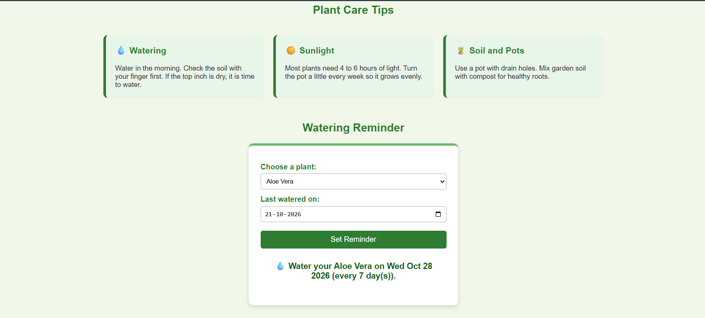

*Figure 7: Watering reminder showing the next watering date (JavaScript)*


---

## 6. Git and GitHub Workflow

**Repository:** https://github.com/Shrutiii27/plant-nursery-catalog

**Commands used:**

```bash
git config --global user.name "Shruti Sawant"
git config --global user.email "my-github-email"
git init -b main
git add .
git commit -m "Initial commit: add basic page structure with plant list"
git remote add origin https://github.com/Shrutiii27/plant-nursery-catalog.git
git push -u origin main
git status
git log --oneline
```

**Workflow followed for every change:**
1. Edit the code in VS Code
2. Test it in the browser
3. `git add .`
4. `git commit -m "message"`
5. `git push`

**Commit history:**

```
b3b8056 docs: fix screenshot file names
8b80bfe feat: add plant care tips section
db2d1ca feat: add plant cards with type, description and price
2042134 style: add green theme and plant card styling
4edeed8 Initial commit: add basic page structure with plant list
```

*(Later commits were added for the watering reminder, the DevOps pipeline and the screenshots. See the final log screenshot below.)*

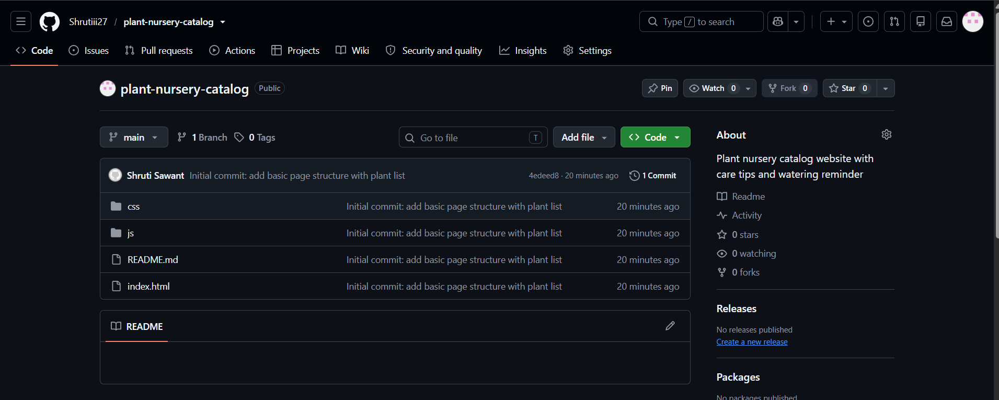

*Figure 8: GitHub repository page*

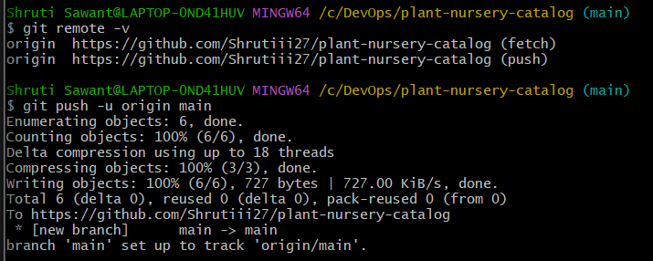

*Figure 9: First push to GitHub*

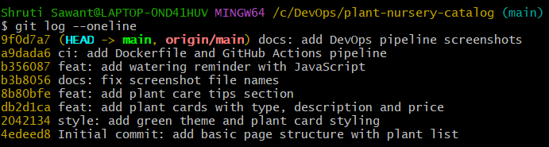

*Figure: Full commit history in Git Bash*

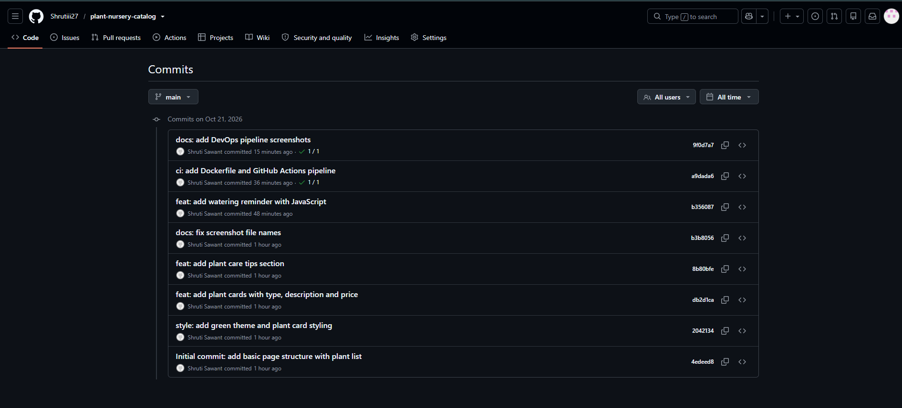

*Figure: Commit history on GitHub*

---

## 7. DevOps Tool Integration: Docker and GitHub Actions

**Tools used:** Docker (to package the website) and GitHub Actions (CI pipeline).

### Step 1: Create the Dockerfile

```dockerfile
FROM nginx:alpine
COPY index.html /usr/share/nginx/html/index.html
COPY css /usr/share/nginx/html/css
COPY js /usr/share/nginx/html/js
EXPOSE 80
```

This uses the Nginx web server image, copies the website files into it, and exposes port 80.

### Step 2: Create the GitHub Actions workflow

File: `.github/workflows/ci.yml`

```yaml
name: CI Pipeline

on:
  push:
    branches: [ "main" ]
  pull_request:
    branches: [ "main" ]

jobs:
  build:
    runs-on: ubuntu-latest

    steps:
      - name: Checkout code
        uses: actions/checkout@v4

      - name: Check website files exist
        run: |
          test -f index.html
          test -f css/style.css
          test -f js/script.js
          echo "All website files found"

      - name: Build Docker image
        run: docker build -t plant-nursery-catalog .

      - name: Run container and test website
        run: |
          docker run -d -p 8080:80 --name plant-site plant-nursery-catalog
          sleep 5
          curl -f http://localhost:8080
          echo "Website is running successfully"
```

### Step 3: Push the code

```bash
git add .
git commit -m "ci: add Dockerfile and GitHub Actions pipeline"
git push
```

Every push to `main` now starts the pipeline automatically.

### Step 4: Check the result in the Actions tab

The pipeline checks the files, builds the Docker image, runs the container and tests the website with `curl`.

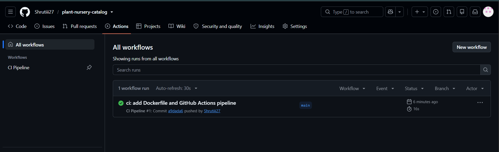

*Figure 10: GitHub Actions run with a green tick (Success)*

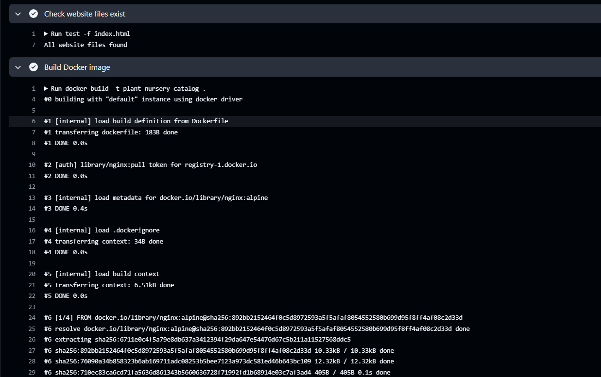
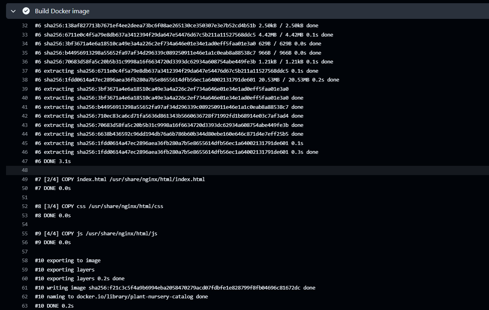

*Figure 11: Pipeline steps passed: files check, Docker build and website test*

---

## 8. Conclusion

The GreenLeaf Nursery Catalog website was built with HTML, CSS and JavaScript. Its 5 changes were committed step by step with Git and pushed to GitHub. A Docker image and a GitHub Actions pipeline now build and test the website automatically on every push.